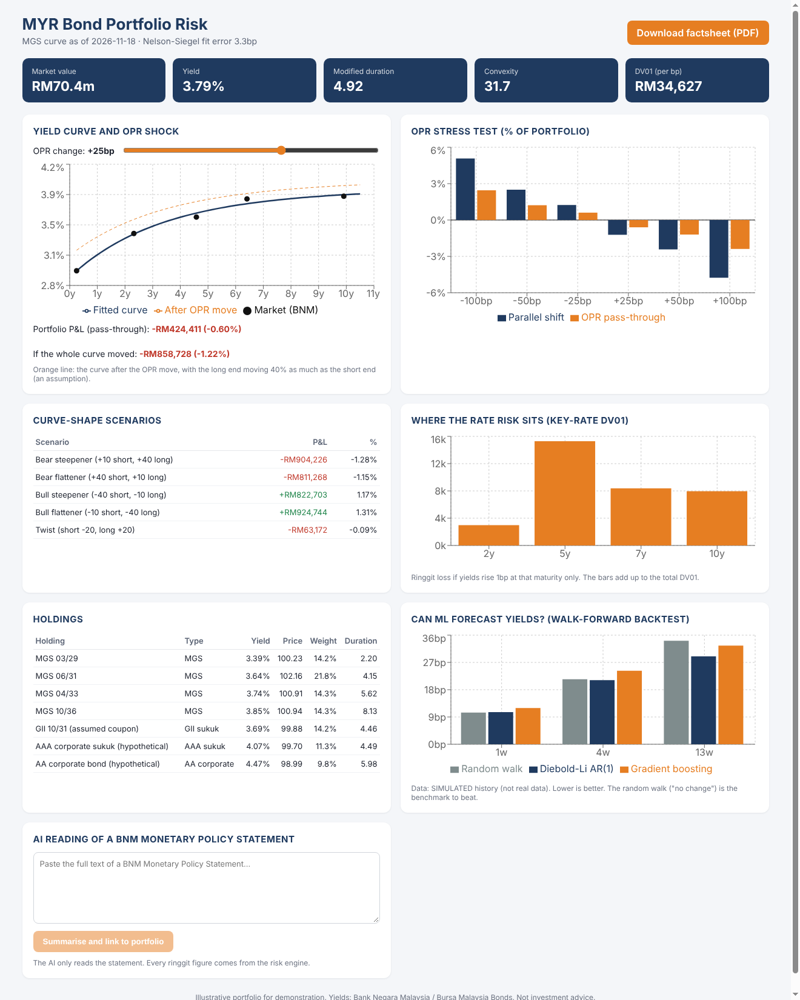

# MYR Bond Portfolio Risk Platform

A full-stack risk tool for a Malaysian ringgit bond and sukuk portfolio. It fits the Malaysian Government Securities (MGS) yield curve from Bank Negara Malaysia data, measures the portfolio's interest-rate risk, stress-tests it against Overnight Policy Rate (OPR) moves and curve-shape changes, backtests ML yield forecasts against a random walk, uses an LLM to read BNM Monetary Policy Statements, and generates a one-page factsheet PDF. All of it is served through a FastAPI backend and a React dashboard.



## Features

| Module | What it does |
|---|---|
| `bondrisk/bond.py` | Bond price, yield, Macaulay and modified duration, convexity, DV01 (semi-annual coupons, as for MGS) |
| `bondrisk/curve.py` | Nelson-Siegel yield curve fit (level, slope, curvature) |
| `bondrisk/portfolio.py` | Portfolio valuation off the curve plus a credit spread per holding |
| `bondrisk/stress.py` | OPR shocks (parallel and maturity-decaying pass-through), curve-shape scenarios, key-rate durations |
| `bondrisk/forecast.py` | Diebold-Li factor model and gradient boosting, walk-forward backtested against a random walk |
| `bondrisk/mps.py` | LLM reading of a BNM Monetary Policy Statement, linked to engine-computed portfolio impact |
| `bondrisk/factsheet.py` | One-page portfolio risk factsheet (PDF) |
| `bondrisk/data.py` | Bank Negara Malaysia Open API client with a resumable history backfill |
| `api/main.py` | FastAPI REST API (docs at `/docs`) |
| `web/` | React + TypeScript dashboard (Vite, Recharts) |

## Results on the sample portfolio (18 Nov 2026 MGS curve)

| | |
|---|---|
| Market value | RM70.4m |
| Weighted yield | 3.79% |
| Modified duration | 4.92 |
| DV01 | RM34,600 per bp |
| Curve fit error | 3.3bp |

**What the numbers show:**
- **A 25bp OPR hike costs about RM424k,** assuming the long end of the curve moves 40% as much as the short end. If the whole curve moved by 25bp, the loss would be about RM859k (≈ DV01 × 25, a sanity check).
- **Rate cuts gain more than equal hikes lose** (+RM3.58m vs −RM3.35m at 100bp). That gap is convexity.
- **Rate risk is concentrated at the 5-year point:** RM15.3k of the RM34.6k DV01. The key-rate DV01s add up to the parallel DV01.
- **A bear steepener (long end up 40bp) hurts more than a bear flattener** (−RM904k vs −RM811k), because most of the portfolio's duration sits beyond 5 years.

The forecasting results in `output/backtest.png` come from **simulated** data until you run `scripts/fetch_history.py`. Do not quote them before then.

## Setup

```bash
pip install -r requirements.txt
python -m pytest -q                       # 18 tests

python scripts/run_report.py              # curve, portfolio, stress tests, charts
python scripts/make_factsheet.py          # output/factsheet.pdf

python scripts/fetch_history.py --probe   # check one BNM API response
python scripts/fetch_history.py --years 5 # backfill real yield history (resumable)
python scripts/run_backtest.py            # ML vs random walk on that history

# AI statement reader (needs an Anthropic API key)
$env:ANTHROPIC_API_KEY="sk-..."           # PowerShell
python scripts/summarise_mps.py statement.txt
```

**Dashboard** (two terminals):
```bash
uvicorn api.main:app --reload             # API on http://localhost:8000
cd web && npm install && npm run dev      # dashboard on http://localhost:5173
```

## Methods

**Nelson-Siegel curve.** Each yield is a level, plus a slope term that matters most at short maturities, plus a curvature term for the hump. With tau fixed, the other three parameters are linear, so they're solved exactly by least squares over a grid of tau values. Tau is limited to 0.3–3 years: with only five benchmark points it is weakly identified, and wider values extrapolate badly beyond 10 years.

**Stress tests.** Every scenario fully reprices every bond, rather than relying on a duration approximation. OPR pass-through is `w(t) = 0.4 + 0.6·e^(−t/3)`, so it is close to 100% at the short end and falls towards 40% at the long end. This is an illustrative assumption; once history is available, it can be estimated from yield moves on past OPR decision days.

**Key-rate durations.** These use triangular 1bp bumps at 2, 5, 7 and 10 years, which together make up a parallel shift.

**Forecasting.** Each week the curve is reduced to three Diebold-Li factors (with tau fixed at 1.37 years). Three models then forecast those factors 1, 4 and 13 weeks ahead:
- a random walk, which assumes no change;
- an AR(1) model on each factor;
- gradient boosting on the factors' levels and recent momentum.

The backtest is strictly walk-forward: each forecast uses only data available on its date, and the models are refitted every 13 weeks. Yields are close to a random walk at short horizons, so beating "no change" is the real test.

**AI statement reader.** The LLM only reads the BNM statement and returns structured JSON: the decision, stance, key points and bias for the next move. Its output is checked against an allowed set of values. Every ringgit figure is computed by the risk engine, so the model cannot invent numbers. The tests use a stub in place of the real API.

## Data

- `data/mgs_curve_2026-11-18.csv`: MGS closing yields and the 3-month T-bill yield from [Bank Negara Malaysia](https://www.bnm.gov.my/government-securities-yield) (source: BNM and Bursa Malaysia Bonds). Maturities are counted from 18 Nov 2026.
- `data/sample_portfolio.csv`: an **illustrative** portfolio. The four MGS use real coupons and maturities. The GII coupon and both corporate bonds (with their spreads) are hypothetical.
- The BNM Open API (`https://api.bnm.gov.my`) needs the header `Accept: application/vnd.BNM.API.v1+json`. Its JSON fields aren't fully documented, so the parser searches for tenure and closing-yield fields. Run `--probe` to confirm them before a long backfill.

## Simplifications

- Settlement is assumed on a coupon date, so there's no accrued interest.
- Each bond is discounted at a single yield (curve plus spread), not off a bootstrapped zero curve.
- Credit spreads stay fixed under stress. In a real sell-off, corporate spreads usually widen.
- The GII and corporate bonds are valued off the MGS curve plus a spread.
